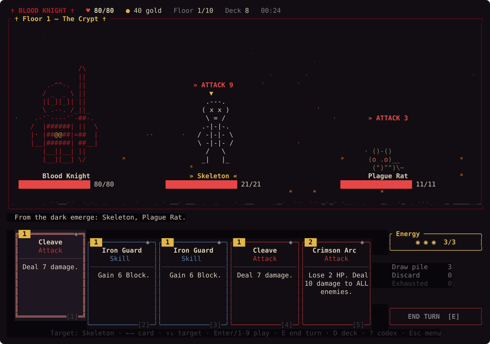

# Crypts of the Unholy

A dark fantasy roguelike deckbuilder for the terminal, written in Rust with ratatui.
Descend ten floors of a cursed crypt and destroy Morvath, the Unholy Abbot. A run takes about ten minutes.



## Install

Download the archive for your platform from the **Releases** page:

| Platform | File |
|---|---|
| Linux x86_64 | `crypts_of_the_unholy-<version>-linux-x86_64.tar.gz` |
| Linux ARM64 (Raspberry Pi 4/5, 64-bit OS) | `crypts_of_the_unholy-<version>-linux-aarch64.tar.gz` |
| macOS (Apple Silicon) | `crypts_of_the_unholy-<version>-macos-aarch64.tar.gz` |
| Windows x86_64 | `crypts_of_the_unholy-<version>-windows-x86_64.zip` |

**Linux / macOS:** extract it and move the binary onto your `PATH`:

```sh
tar xzf crypts_of_the_unholy-*.tar.gz
mkdir -p ~/.local/bin
mv crypts_of_the_unholy-*/crypts_of_the_unholy ~/.local/bin/
crypts_of_the_unholy
```

On macOS the binary is not notarized. If Gatekeeper blocks it, clear the quarantine flag once:
`xattr -d com.apple.quarantine ~/.local/bin/crypts_of_the_unholy`

**Windows:** extract the zip and run `crypts_of_the_unholy.exe` from Windows Terminal
(the old console host lacks truecolor).

Each release includes a `SHA256SUMS` file for verifying downloads.

**From source** (Rust 1.88+):

```sh
cargo install --path .
```

## Run

```sh
cargo run --release
```

You need a terminal of at least 90x30 (120x40 or larger looks best) with truecolor support.

## Tutorial

New to the game? Choose **Tutorial** on the title screen for a short guided fight: a Blood Knight
against a lone Ghoul. A guide panel walks you through enemy intents, Energy and card costs,
attacking, Block, spending HP for power, and ending your turn. Your saved run is never touched,
and you can leave at any time from the `Esc` menu.

## Classes

| Class | HP | Style |
|---|---|---|
| **Blood Knight** | 80 | Heavy armor, greatsword. Cards cost HP; *Blood Armor* turns lost HP into Block. |
| **Assassin** | 62 | Fast and light. Cheap cards, Combo bonuses, Poison, Dodge. Draws 6 per turn. |
| **Warlock** | 66 | Gravewood staff. Stacks *Doom*: an enemy whose Doom ≥ HP dies at the end of your turn. |

## Controls

| | Keyboard | Mouse |
|---|---|---|
| Select | arrows / `hjkl` / `wasd` | hover |
| Confirm / play card | `Enter`, `Space`, `1`-`9` | left click |
| Change target | `↑` `↓` / `Tab` | click an enemy |
| End turn | `E` | click **END TURN** |
| Deck / Codex | `D` / `?` | |
| Menu / back | `Esc` | right click |

## Saving

The run is saved automatically before each room, to
`$XDG_DATA_HOME/crypts_of_the_unholy/save.json` (default `~/.local/share/...`).
If you quit mid-room, you restart that room as it was when you entered.
Choose **Continue** on the title screen to resume.

## Tests

```sh
cargo test --release -- --test-threads=1
```

A bot plays 90 full runs through the real input and render code at two terminal sizes,
and plays the tutorial from start to finish.

## License

Copyright (C) 2026 Salvatore Laisa

This program is free software: you can redistribute it and/or modify it under the terms of the
GNU General Public License as published by the Free Software Foundation, either version 3 of the
License, or (at your option) any later version. See [LICENSE](LICENSE) for the full text.
